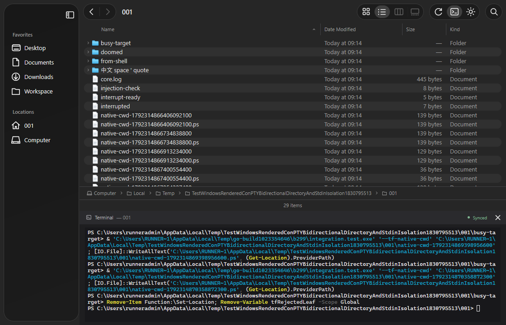
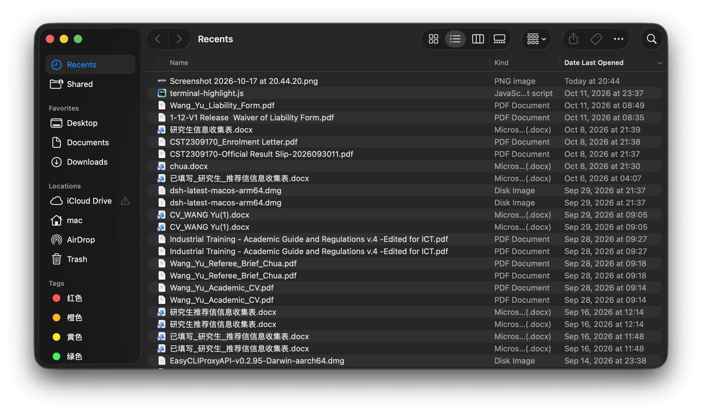
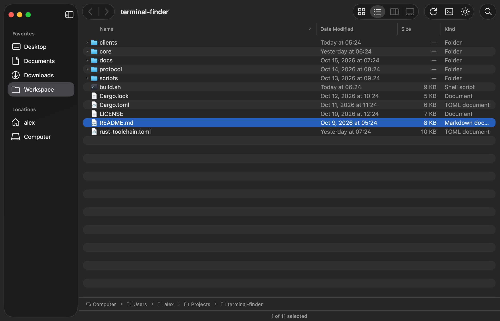
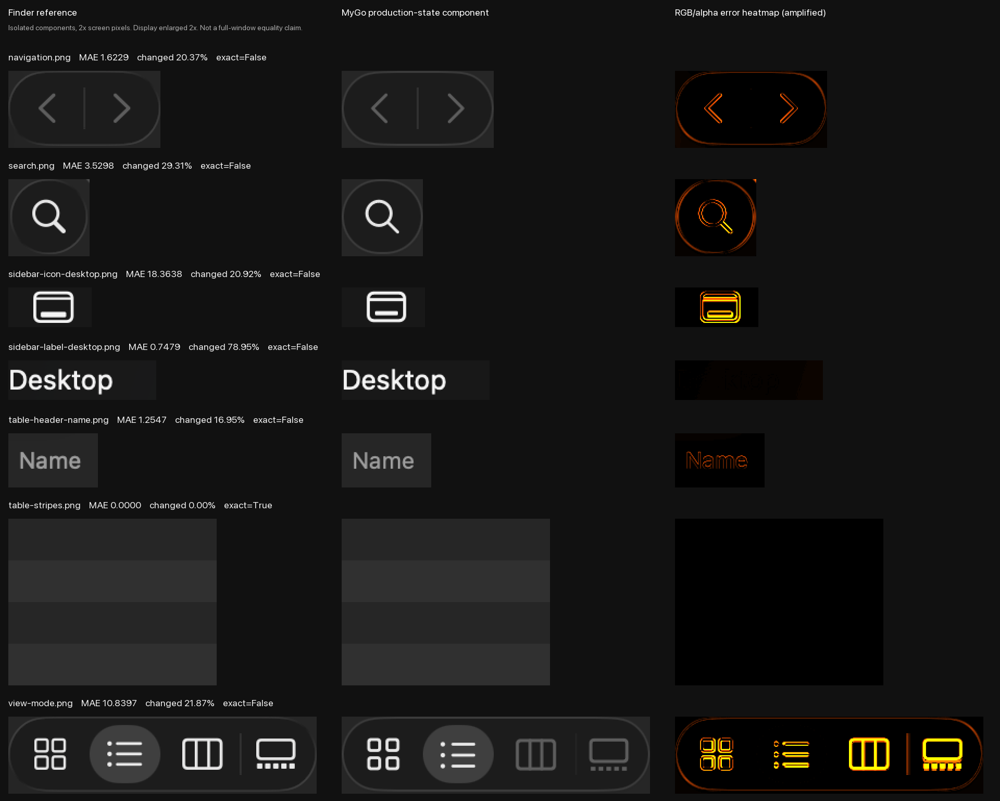

# Windows agent 交接：MyGo 自绘 Terminal Finder

更新日期：2026-10-18。分支：`codex/mygo-drawn-windows-handoff`。主分支基线：`11fa3289d6e75bb7509c143622b5d3713120e344`。

本分支保留原仓库历史，在 `clients/MyGo/` 提供共享 Go/MyGo 自绘 UI，Rust core 仍拥有目录事实和终端会话。Windows 已加入原生 ConPTY / PowerShell 实现，macOS zsh/FIFO 实现保持独立。默认 Swift/AppKit 客户端继续使用进程内 UniFFI；只有这个 Go 实验客户端使用可选 HTTP/WebSocket sidecar。

## 原生 Windows 构建与运行

需要原生 Git、Go1.27.1+（CI使用1.27.2）、Rust MSVC 工具链，以及 PATH 中的 PowerShell7.2+ `pwsh.exe`。shell 使用 PSReadLine2.2+；不支持 Windows PowerShell5.1，不修改用户 profile。MyGo 固定0.5.5。

```powershell
git clone --branch codex/mygo-drawn-windows-handoff https://github.com/yangyu370/terminal-finder.git
Set-Location terminal-finder\clients\MyGo
.\build-windows.ps1
.\dist\terminal-finder-drawn.exe --dark --workspace 'C:\work\project'
.\test-windows.ps1
```

完整构建编译同仓 Rust server，按 MyGo 锁定元数据下载并校验对应架构的 Ghostty VT DLL；`core.exe`、`ghostty-vt.dll` 与客户端 exe 放在同一目录。使用 `-PreviewOnly` 可只构建 UI，再以 `--demo --dark` 启动固定样例；demo 不证明后端或 shell 可用。故障诊断时可去掉构建命令的 `-H=windowsgui` 保留控制台。

真实模式的固定开发地址为 `127.0.0.1:3587`。托管启动持有 core stdin，关闭时回收自己创建的 core；若端口占用，报告错误或显式 `--connect`，不能杀已有进程。连接共享 core 时客户端退出不关闭它。

## 同步设计与代码入口

UI 导航先由 core 验证/列目录，再通过独立的不可变 JSON 请求排队。PowerShell 在提示符或 PSReadLine 空输入缓冲区的 OnIdle 时应用最新请求；前台程序持有 stdin 时不执行导航。请求始终是数据，不能拼入 shell 命令。成功后发出真实 cwd 的 OSC7；core 校验后 Go 才显示 Synced。失败通过 completion 回到已有 `terminal_control_failed` 错误；queued 本身不代表切换完成。

| 位置 | 责任 |
|---|---|
| `clients/MyGo/cmd/terminal-finder-drawn/main.go` | 共享窗口、终端和资源装配 |
| `clients/MyGo/internal/launch/` | exe 相邻资源、core 托管与清理 |
| `clients/MyGo/internal/workspace/` | 最新导航、过期报告、规范化路径确认、历史与错误状态 |
| `clients/MyGo/internal/backend/` | 现有 RPC/WS、PTY 原始字节，不能另开客户端 shell |
| `core/src/terminal/session.rs` | 本地平台 shell、ConPTY/PTY、进程生命周期 |
| `core/src/terminal/shell_integration/` | Unix zsh 与 Windows PowerShell hook |
| `core/src/terminal/windows_control.rs` | 每会话独立的有序原子控制请求 |
| `core/src/terminal/cwd_url.rs` | Windows 盘符/UNC URL 路径转换 |
| `core/src/ffi/terminal.rs`、`core/src/terminal/websocket.rs` | 相同 cwd 校验、authority 限制与协议语义 |
| `clients/MyGo/internal/integration/windows_test.go` | 真 core、真 PowerShell/ConPTY、Ghostty/MyGo 渲染与原生子进程验证 |

DLL 元数据来自 `go list -m -f '{{.Dir}}' github.com/egoist/mygo` 对应模块中的 `plugins/terminal/mygo-plugin.json`。支持 `MYGO_GHOSTTY_VT` 显式路径。不要提交 `.tools/`、`.cache/`、`dist/` 或原生库二进制。

## 自动化证据与剩余验收

Windows x64 原生自动化已通过：[完整 CI 记录](https://github.com/yangyu370/terminal-finder/actions/runs/39114335844)，被测源码提交 `c09471f`。Rust Windows 路径、控制文件和 FFI/WS 契约5项通过；Go 的 vet 与全部包测试通过，真实 ConPTY/MyGo/Ghostty 闭环用例耗时5.34秒。日志确认 C→D→C、PowerShell/原生子进程 cwd、shell-only `terminal_control_failed`，以及 PID1760 退出。

- [下载 Windows x64 MVP 包](https://github.com/yangyu370/terminal-finder/actions/runs/39114335844/artifacts/12131284615)：解压后保留两个 exe 与 DLL 在同一目录，使用 `--dark --workspace 'C:\work\project'` 启动；仍需要 PATH 中的 PowerShell7.2+ 和 PSReadLine2.2+。
- [下载原生测试日志与截图](https://github.com/yangyu370/terminal-finder/actions/runs/39114335844/artifacts/12131917604)。本地脚本也保存 `.cache/windows-tests.log` 与 `.cache/windows-terminal.png`。
- CI入口：`.github/workflows/mygo-windows.yml`。后续代码修改必须重跑，不能用交叉编译或跳过真实用例替代。

下图来自上述 Windows runner 的真实 Rust/PowerShell 会话，1120×720px、1x，由 MyGo 软件渲染器导出；它是自动化渲染结果，不是物理桌面截图：



原生测试覆盖：UI→shell 和 shell→UI，PowerShell 与原生子进程各自的 cwd，中文/空格/单引号，Ctrl+C 中断与恢复，连续导航，前台 stdin 隔离，shell 端拒绝目录切换，resize、面板隐藏/恢复与 shell 退出。本次实际覆盖 C/D 盘符切换；未来测试机没有第二可写盘符时，日志会明确指出未覆盖。UNC URL 有 FFI/WS 单元测试，真实网络共享仍需单独验收。

macOS 回归：Rust209项测试、fmt、clippy 和 MyGo `./build-drawn.sh` / `./test.sh`（vet、race、真实PTY与Ghostty渲染）通过。已刷新静态 FFI 库，生成接口无变更。Swift/Xcode 测试受本机未接受 Xcode license 阻止，尚未执行。

继续在 Windows 物理桌面验收：100%/125%/150%/200% DPI、中文输入法、字体 fallback、焦点、快捷键、窗口按钮、默认应用打开文件、真实 UNC 权限/断连、休眠与异常终止；Windows ARM64仍需原生运行验收。macOS 底层由 MyGo 使用 AppKit/CoreText，Windows 使用自己的平台后端；共享组件不意味着文字像素天然相同。

## Finder 截图与视觉目标

以下 Finder 原图由用户提供，保持原始 PNG 字节，2306×1362px。SHA-256：`d02c1a0bb4f062578f4024c7658c7039601843a00d57e96becefdbbdd36fb1dc`。仅作交接参考，不参与产品 UI 绘制。



当前 Go 自绘预览使用明确的固定样例数据；文件名和可用功能不与 Finder Recents 一一对应：



逐组件对照：左为 Finder 原始裁剪，中间为 Go 实际组件状态，右为放大的原始像素误差。分栏/画廊在 MVP 中禁用，主报告保留其与 Finder 参考的状态差异。



已校准的基准在 `clients/MyGo/internal/finderui/metrics.go`：工具栏52pt、侧栏总跨度176pt（含MyGo分隔条）、表头区28pt、列表行20pt、左右内收10pt、行顶部5pt、正文/侧栏13pt、表头11pt、标题15pt。圆角和 SVG 光学尺寸部分仍为拟合值。完整说明见 [像素审计](clients/MyGo/FINDER_PIXEL_AUDIT.md)。

目前只有交替行**内部取样**完全相同，不代表整行/整窗一致。材质、文字抗锯齿、文件类型图标和部分矢量边缘仍有差异；不要用原生截图作整窗纹理，也不要放宽像素门禁来宣称通过。浅色/hover/pressed/inactive 尚无同状态原生基准。

## 必须保留的契约与验收

- core拥有目录事实、workspace state与进程生命周期；Go只持有选择、焦点、布局等客户端状态。真实文件列表不能偷偷改成Go `os.ReadDir`。
- `workspaceRoot`是上下文根，不是安全沙箱；root内导航保持root，root外导航重设root；`listDirectory`无状态；目录验证和listing全部成功后才原子更新。
- 本轮不新增删除、重命名等UI写入口，不绕过现有文件变更护栏；不顺带实现S3、索引、插件等无关功能。
- UI进入目录后检查**真实PowerShell cwd**；shell执行 `Set-Location -LiteralPath` 后检查core和UI；无效/不可访问目录保留旧listing并显示错误。
- 快速A→B→C与过期报告不回滚；queued到达不能提前显示Synced；前台程序读stdin期间不收到导航命令，退出后再同步。
- resize合并后的rows/cols有效；隐藏/恢复终端保留同一会话；退出app回收自己创建的core及shell；连接模式不结束共享core。
- core路径比较覆盖 `C:\...`、`D:\...`、UNC、中文、空格、引号、拒绝控制字符；别只在WSL `/mnt/c`上验收。
- backend语义/FFI DTO若变更，同步Rust测试、FFI facade、Swift绑定/客户端与协议。仅内部core改动也需刷新macOS静态库验证；沿用根 README 的构建与FFI刷新流程。

## 视觉门禁

`./verify-pixels.sh` 当前返回2，保留真实残差；不能因功能测试通过而宣称像素一致。参考原图哈希与sRGB转换说明见 `clients/MyGo/internal/finderui/testdata/finder26-dark/provenance.json`。后续适配不能放宽阈值掩盖平台字体/材质差异。
